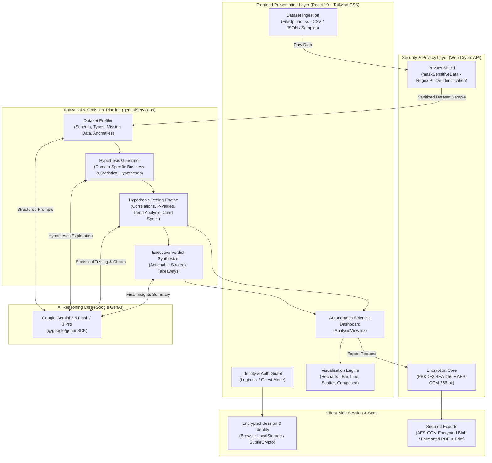

# DataSage - Autonomous Data Scientist

DataSage is an intelligent autonomous agent that cleans raw data, generates hypotheses, runs statistical tests, and visualizes insights using the Gemini 3 Pro model.

## Prerequisites

Before running the project, ensure you have the following installed:
- [Node.js](https://nodejs.org/) (Version 18 or higher)
- [npm](https://www.npmjs.com/) (comes with Node.js)

## Setup Instructions

1. **Extract the ZIP**: Unzip the project folder to your local machine.
2. **Install Dependencies**: Open your terminal in the project folder and run:
   ```bash
   npm install
   ```
3. **Configure API Key**: 
   - Create a file named `.env` in the root directory.
   - Add your Gemini API key from [Google AI Studio](https://aistudio.google.com/app/apikey):
     ```env
     API_KEY=your_actual_api_key_here
     ```

## Running the App

To start the development server, run:
```bash
npm run dev
```

Once the server starts, open your browser to the URL shown in the terminal (usually `http://localhost:5173`).

## System Architecture



### Architectural Workflow

1. **Identity & Auth Boundary**: Validates researcher access using PBKDF2/SHA-256 identity hashing or instant guest demonstration access.
2. **Data Ingestion & Privacy Shield**: Accepts CSV/JSON datasets or built-in domain samples. If Privacy Shield is enabled, PII (emails, phone numbers, addresses, identities) is de-identified on the client before leaving the browser.
3. **Autonomous Scientific Loop**:
   - **Data Profiling**: Analyzes data structures, distributions, missing values, and anomalies.
   - **Hypothesis Generation**: Formulates candidate business and statistical hypotheses.
   - **Hypothesis Testing**: Computes statistical significance, correlation coefficients, p-values, and visualization configurations.
   - **Executive Verdict**: Synthesizes findings into high-level business decisions and strategic steps.
4. **Interactive Visualization & Export**: Renders dynamic charts via Recharts and provides client-side AES-GCM 256-bit encrypted report exports.

---

## Project Structure

- `App.tsx`: Main application orchestrator and workflow state machine.
- `services/geminiService.ts`: Integration with the `@google/genai` SDK for dataset profiling, hypothesis testing, and verdicts.
- `services/securityService.ts`: Client-side Web Crypto API (SubtleCrypto PBKDF2 + AES-GCM) and regex PII data masking.
- `services/authService.ts`: Session identity handling and credentials validation.
- `components/FileUpload.tsx`: CSV/JSON file upload, parser, and built-in sample datasets.
- `components/AnalysisView.tsx`: Interactive dashboard, statistical test results, and Recharts graphs.
- `components/Login.tsx`: Identity authentication gate with guest mode.
- `types.ts`: TypeScript contracts for datasets, hypotheses, and analytical outcomes.

